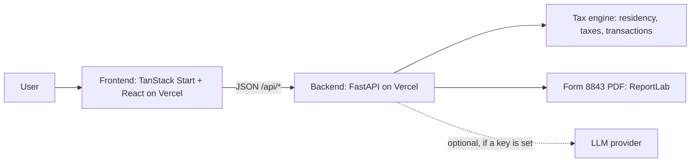

# ARATax

**Your US taxes, finally clear.**

ARATax is an AI-assisted tax workspace for US freelancers on 1099 and immigrants on work and study visas (F-1, OPT, J-1, H-1B, O-1). It works out your tax residency, tells you which federal form to file, estimates what you owe and finds money you can get back.

- Live app: https://aratax-seven.vercel.app
- Paywall demo: https://aratax-seven.vercel.app/?plan=free
- API docs: https://ara-api-orpin.vercel.app/docs

Built in 24 hours for Zimran Business Cup 2026. Track: Money.

---

## 1. The problem

- Your tax residency decides your form: residents file **Form 1040**, nonresidents file **Form 1040-NR**.
- Many popular tax programs only support Form 1040. Filing the wrong one means an amended return (**Form 1040-X**), interest, penalties and delayed refunds.
- 1099 freelancers have no withholding and often miss **quarterly estimated payments** (Form 1040-ES).
- F-1 / OPT students are usually exempt from FICA (Social Security + Medicare), but employers often **withhold it by mistake**, and most people never claim it back.

## 2. Who it's for

US-based adults aged 25-45:

| Segment | Typical situation |
|---|---|
| F-1 / OPT students and graduates | Nonresident for the first 5 calendar years, Form 1040-NR + Form 8843, FICA often withheld by mistake |
| J-1 students and scholars | Exempt-individual day counting, Form 8843 |
| H-1B / O-1 in the first years | Substantial presence test decides 1040 vs 1040-NR |
| Mid-year visa change (e.g. OPT → H-1B) | Dual-status / First-Year Choice questions |
| 1099 freelancers | Self-employment tax, deductions, quarterly payments |

## 3. Features

All calculations are for **tax year 2026** (2025 is still accepted by the API).

| Feature | Plan |
|---|---|
| Chat assistant (EN / RU / ES) that collects your profile and answers tax questions | Free: 5 messages, Pro: unlimited |
| Residency check: substantial presence test, exempt years for F/J/M/Q, dual-status detection | Free |
| Which form to file (1040, 1040-NR, dual-status, Form 8843) | Free |
| Tax owed / refund headline | Free |
| Federal income tax + self-employment tax for W-2, 1099 and hybrid income, full breakdown | Pro |
| FICA refund detector (Form 843 + Form 8316 guidance) | Pro |
| Bank statement deduction finder (CSV or manual transactions, rule-based) | Pro |
| Quarterly 1040-ES schedule + IRS Direct Pay link | Pro |
| Pre-filled Form 8843 PDF | Pro |
| Calculation history (last calculation in Free) + side-by-side compare | Free / Pro |
| AI explanation of your results | Pro |
| Light / dark theme | Free |
| Paywall: Free vs Pro $12/month with a test-mode checkout | Free |

## 4. AI vs code

| Part | How it works |
|---|---|
| Federal income tax, SE tax, QBI, standard deduction | Deterministic Python (`app/services/taxes.py`), tested |
| Substantial presence test, exempt years, dual-status | Deterministic Python (`app/services/residency.py`), tested |
| FICA refund, quarterly 1040-ES schedule | Deterministic Python, tested |
| Form 8843 PDF | Deterministic Python + ReportLab (`app/services/pdf_8843.py`) |
| Reading amounts from chat ("$85 000", "85k", "85 тыс", "eighty-five thousand") | Deterministic parser (`app/money.py`), tested |
| Bank transaction categorization | Keyword rules (`app/services/transactions.py`), not AI |
| Chat replies and result explanations | LLM (OpenRouter, OpenAI, DeepSeek, Groq or Gemini, whichever key is set). Extracted profile fields are validated against the user's message; without a key or on failure a deterministic FAQ / template fallback answers |

**The LLM never calculates taxes.** It only explains numbers that the Python engine produced.

## 5. Test cases for judges

### Demo presets ("Quick start" on the New calculation page)

| Preset | Result |
|---|---|
| 1. F-1 OPT graduate: W-2 + 1099 freelance | Nonresident, Form 1040-NR + Form 8843 (PDF), FICA refund $3,442.50, total tax ~$8,722 |
| 2. F-1 OPT → H-1B on Oct 1, 2026 | Nonresident, 92 countable days, First-Year Choice available, total tax ~$14,763, demo Form 8843 PDF |
| 3. O-1 full-time 1099 contractor | Resident alien under SPT (289 countable days), Form 1040 + FBAR note, SE tax applies, total tax ~$25,154 |

### Scenarios

1. **Chat (EN or RU):** "I'm on F-1, entered the US on Sept 1, 2023" → "Only 1099: $85,000" → "No expenses ($0)". Expected: nonresident, Form 1040-NR, estimated federal tax ~$9,672, and a note to check 1099 work authorization with your DSO.
2. **Chat small talk and questions:** "hey how are you?", "how do I pay my taxes?". The assistant answers first, then returns to the next profile question.
3. **Form:** New calculation → add two stays (OPT, then H-1B), leave the last exit date empty (means "still in the US").
4. **Deductions:** New calculation → Bank statement → "Use sample statement" → Calculate → deductions table in Results.
5. **Documents:** run preset 1 → Documents → download Form 8843 (PDF). For a chat calculation without personal data, fill the inline form and generate the PDF.
6. **History:** run 3 calculations → Results → history column → tick 2 cards → Compare.
7. **Paywall:** open `/?plan=free` → locked sections → Upgrade → card `4242 4242 4242 4242`, any future date, any CVC → Pro.
8. **Languages and theme:** switch EN / RU / ES (numbers stay the same) and light / dark theme.

### API (curl)

```bash
API=https://ara-api-orpin.vercel.app

curl $API/api/health

curl "$API/api/demo-presets?language=en"

curl -X POST $API/api/analyze-all -H "Content-Type: application/json" -d '{
  "language": "en",
  "residency": {"stays": [{"visa_type": "F-1", "entry_date": "2024-08-20"}]},
  "taxes": {"visa_type": "F-1", "gross_1099_income": 85000}
}'

curl -X POST $API/api/chat -H "Content-Type: application/json" -d '{
  "language": "en",
  "messages": [{"role": "user", "content": "I am on F-1 since 2024-08-20, only 1099: $85,000"}]
}'
```

## 6. Architecture



```
.
├── api/index.py          # Vercel entry point, exports the FastAPI app
├── app/
│   ├── main.py           # FastAPI routes
│   ├── schemas.py        # Pydantic request/response models
│   ├── config.py         # Tax-year data (brackets, deductions, deadlines)
│   ├── presets.py        # Demo presets
│   ├── i18n.py, faq.py   # EN/RU/ES texts and the offline FAQ
│   ├── money.py          # Amount parser
│   └── services/         # residency, taxes, transactions, advisor (chat/LLM), pdf_8843
├── tests/                # pytest
├── Frontend/             # TanStack Start + React app
├── requirements.txt
└── ARCHITECTURE.md
```

| Method | Path | Purpose |
|---|---|---|
| GET | `/api/health` | Health check |
| GET | `/api/demo-presets?language=` | Demo presets with localized titles |
| POST | `/api/residency/calculate` | Residency status, day counts, filing plan |
| POST | `/api/taxes/calculate` | Federal + SE tax, FICA refund, quarterly plan |
| POST | `/api/transactions/analyze` | Bank statement deduction finder |
| POST | `/api/form-8843/pdf` | Form 8843 as a PDF file |
| POST | `/api/form-8843/base64` | Form 8843 as base64 JSON |
| POST | `/api/explain` | Plain-language explanation (LLM or template) |
| POST | `/api/analyze-all` | Everything above in one call |
| POST | `/api/chat` | Chat turn: reply, collected profile, live estimate |

More detail: [ARCHITECTURE.md](./ARCHITECTURE.md).

<details>
<summary><b>Tech stack, run locally, deploy</b></summary>

## 7. Tech stack

- **Frontend:** React 19, TanStack Start / Router / Query, TypeScript, Vite, Tailwind CSS 4, Radix UI (shadcn/ui), framer-motion, lucide-react, react-markdown, Vitest + Testing Library.
- **Backend:** Python, FastAPI, Pydantic, ReportLab, Uvicorn, pytest.
- **AI:** optional LLM via OpenRouter, OpenAI, DeepSeek, Groq or Google Gemini.
- **Hosting:** Vercel (two projects).

The UI was initially generated with Lovable, then refined by hand.

## 8. Run locally

**Backend**

```bash
python -m venv .venv
source .venv/bin/activate        # Windows: .venv\Scripts\activate
pip install -r requirements.txt
uvicorn app.main:app --reload --port 8000
```

**Frontend**

```bash
cd Frontend
npm install
echo "VITE_API_URL=http://localhost:8000" > .env.local
npm run dev
```

**Tests**

```bash
pip install pytest httpx
python -m pytest
cd Frontend && npm test
```

**Environment variables**

| Variable | Where | Purpose |
|---|---|---|
| `VITE_API_URL` | Frontend | Backend base URL |
| `OPENROUTER_API_KEY` | Backend, optional | LLM provider (model via `OPENROUTER_MODEL`) |
| `OPENAI_API_KEY` | Backend, optional | LLM provider (model via `OPENAI_MODEL`) |
| `DEEPSEEK_API_KEY` | Backend, optional | LLM provider |
| `GROQ_API_KEY` | Backend, optional | LLM provider |
| `GEMINI_API_KEY` | Backend, optional | LLM provider |

Without any LLM key the app still works: chat and explanations use the deterministic fallback. Several keys can be given comma-separated.

## 9. Deploy

Two Vercel projects from this repository:

- **Backend:** Root Directory = repository root, FastAPI preset, entry `api/index.py`, no `vercel.json`. Add the LLM keys you want as environment variables.
- **Frontend:** Root Directory = `Frontend`, environment variable `VITE_API_URL` = the backend URL.

</details>

## 10. Business model

| Free | Pro, $12/month |
|---|---|
| Tax residency status | Full federal + self-employment breakdown |
| Tax owed / refund headline | Bank statement deduction finder |
| 5 assistant messages | Quarterly plan + IRS Direct Pay link |
| Last calculation in history | FICA refund guide |
| | Pre-filled Form 8843 PDF |
| | Unlimited chat + AI explanation, full history + compare |

**Value:** one recovered FICA refund (e.g. $3,442.50 on $45,000 of W-2 wages, 7.65%) or one avoided Form 1040-X is worth more than a year of Pro.

**Retention:** quarterly payments four times a year, a filing every year, and new questions with every visa change.

## 11. Limitations and roadmap

**Limitations**

- Federal taxes only, tax years 2025-2026.
- No e-file: it requires an IRS Authorized e-file Provider; planned via a partner.
- Checkout is test mode only; no real payments.
- No data is stored between sessions.
- Transaction categorization is rule-based.

**Roadmap**

- State taxes
- E-file through a partner
- Live Stripe payments
- Bank account sync
- AI-assisted transaction categorization
- Tax treaty benefits by country

## 12. Team

| Name | Role |
|---|---|
| Kudabay Rauan | Team Captain, Frontend Engineer, QA Engineer |
| Ali Abylgazi | Backend Engineer, QA Engineer |
| Assanali Matayev | UI/UX Designer, Product Manager |

## 13. Disclaimer

ARATax provides estimates for informational purposes only and is not a substitute for advice from a licensed tax professional. Not affiliated with the IRS.
